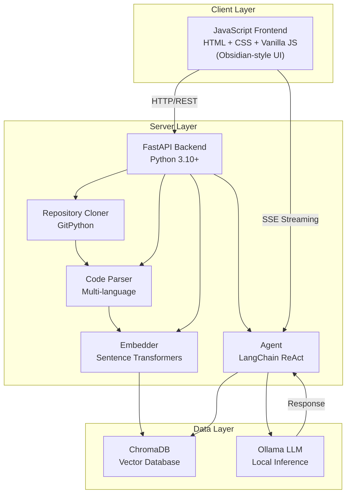
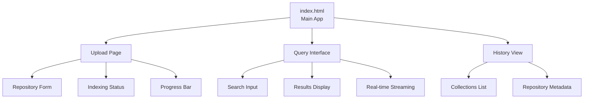
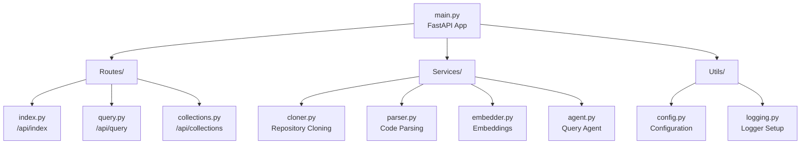
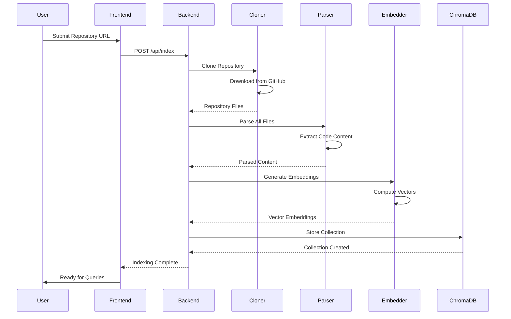
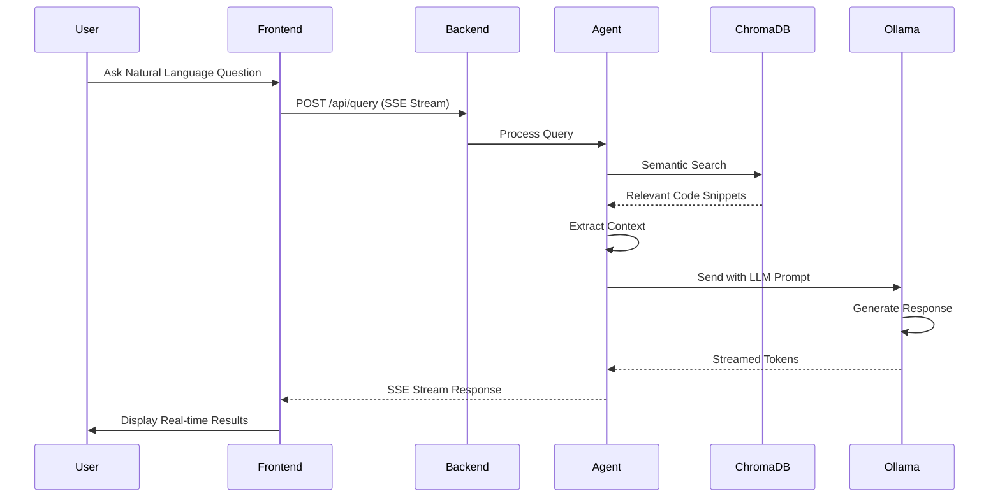
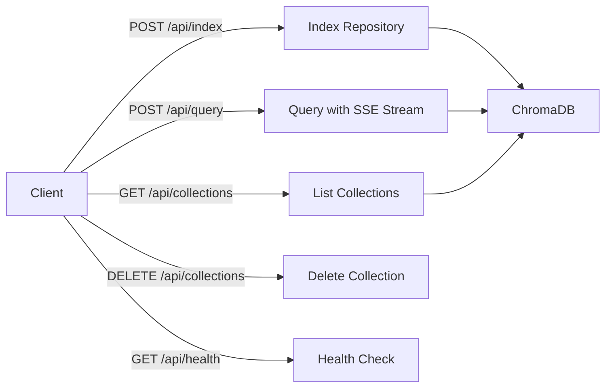
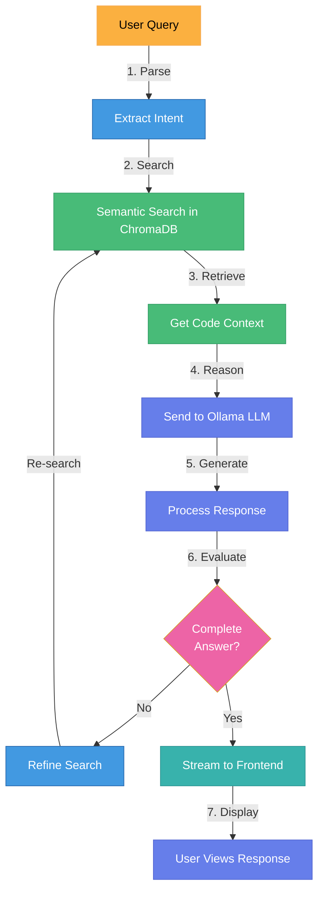
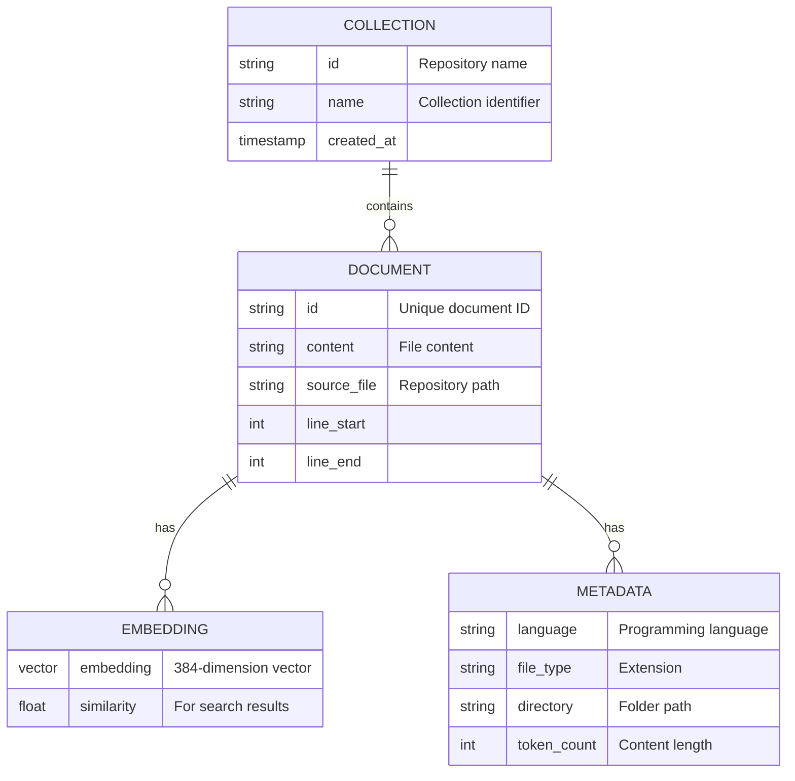
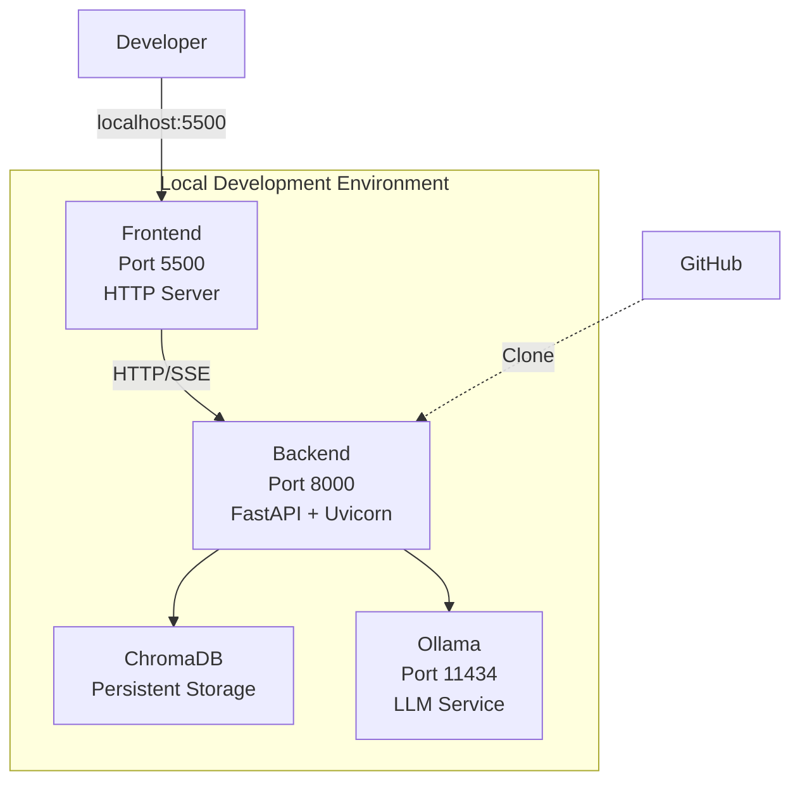

# System Architecture

Technical architecture of the RepoMind: GitHub Repository Intelligence System.

---

## Overview

3-tier architecture with frontend, backend, and data layers for analyzing GitHub repositories through AI-powered semantic search and agentic reasoning.

---

## Component Architecture

### Frontend Components

### Backend Structure

---

## Data Flow

### Indexing Flow

### Query Flow

---

## Technology Stack

- **Frontend**: Vanilla JavaScript, HTML5, CSS3
- **Backend**: FastAPI, Python 3.10+, Uvicorn
- **LLM & Embeddings**: LangChain, Ollama, Sentence-Transformers
- **Vector Database**: ChromaDB, Persistent Collections
- **Repository Tools**: GitPython, Multi-language Parser
- **Streaming**: SSE-Starlette, Real-time Updates
- **DevOps**: Docker, Docker Compose

---

## API Endpoints

---

## Repository Indexing Pipeline

---

## Agent Reasoning Loop

---

## Data Model

### ChromaDB Collection Structure

---

## Deployment Architecture

---

## Supported Languages

✅ Python  
✅ JavaScript / TypeScript  
✅ Java  
✅ Go  
✅ Rust  
✅ C/C++  
✅ C#  
✅ Ruby  
✅ PHP  
✅ And more...

---

## Key Features

🔍 **Semantic Code Search** - Vector embeddings for intelligent retrieval  
🤖 **Agentic Reasoning** - Multi-step problem solving with ReAct patterns  
⚡ **Real-time Streaming** - SSE for responsive user experience  
🔐 **Privacy-First** - Local LLM inference, no external API calls  
📚 **Multi-language Support** - Intelligent parsing across programming languages  
🎯 **Persistent Collections** - Collections stored and retrieved from ChromaDB  

---

*RepoMind: AI-Powered GitHub Repository Intelligence System*
*Combines semantic search, embeddings, and agentic reasoning for intelligent codebase analysis*
