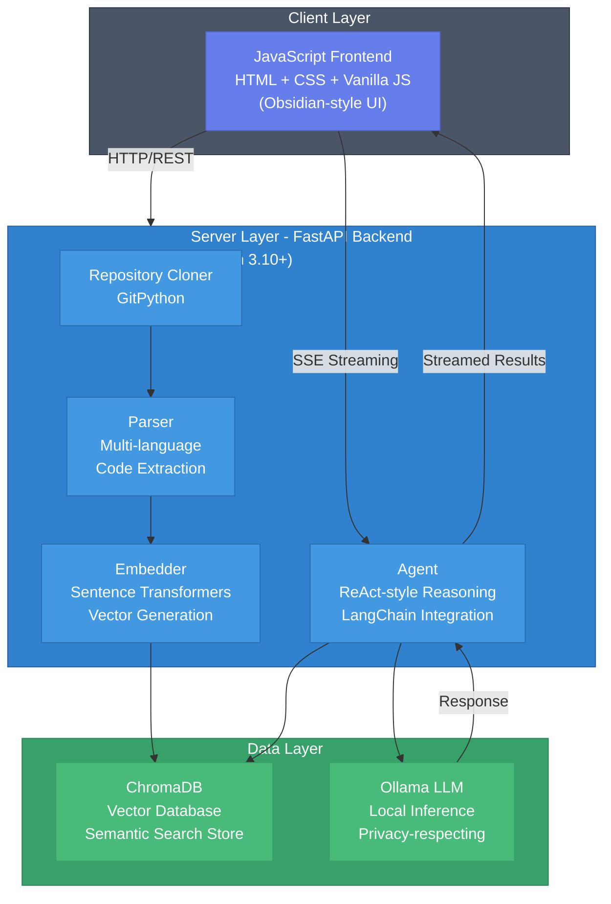
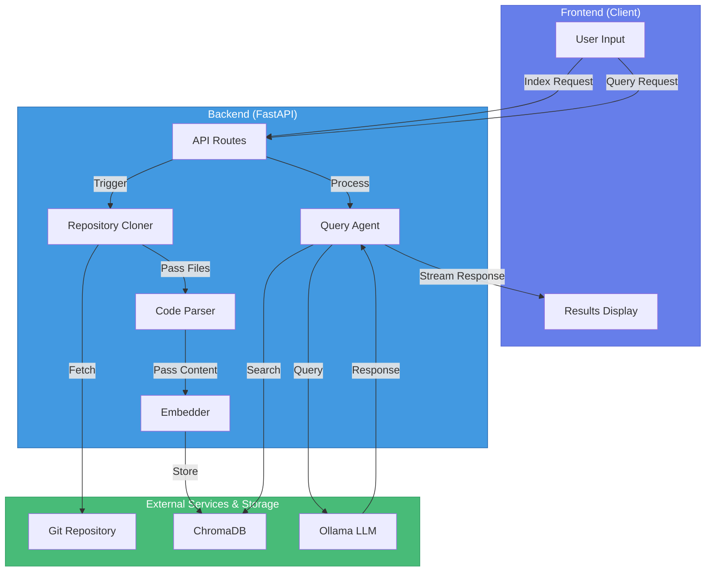
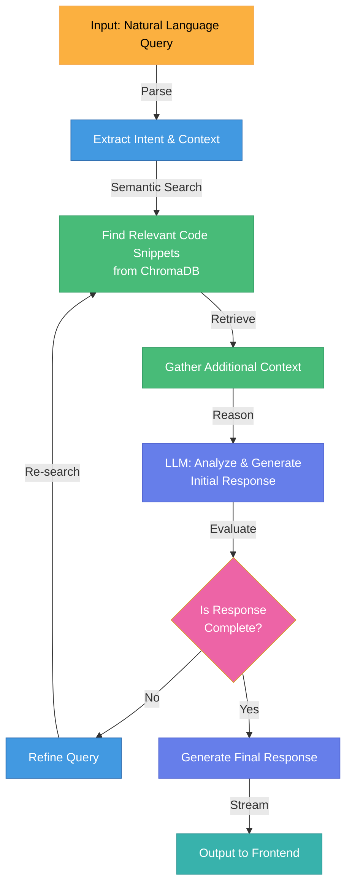
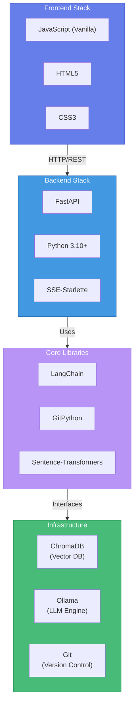

# RepoMind Architecture & Methodology Diagrams

## System Architecture Diagram

## Repository Analysis Workflow

## Query Processing Pipeline

## Component Interaction Diagram

## Methodology: Multi-Step Reasoning Loop

## Technology Stack Visualization

---

*RepoMind: AI-Powered GitHub Repository Intelligence System*
*Combines semantic search, embeddings, and agentic reasoning for intelligent codebase analysis*
